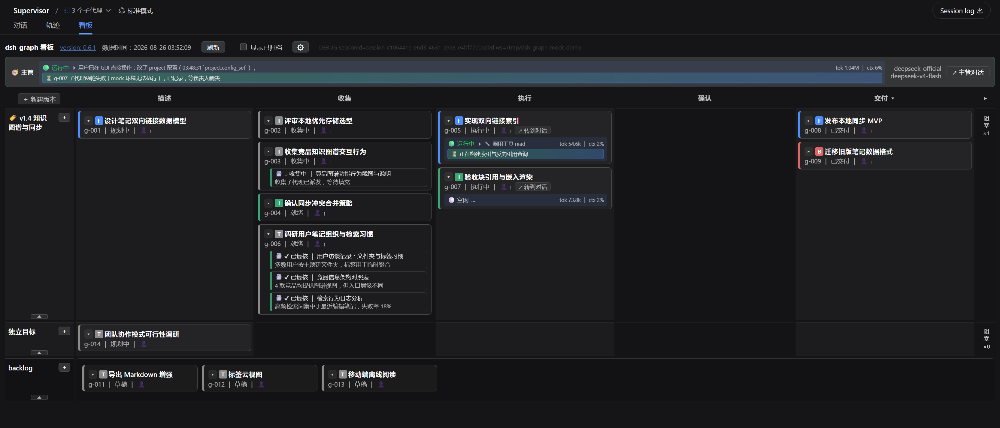
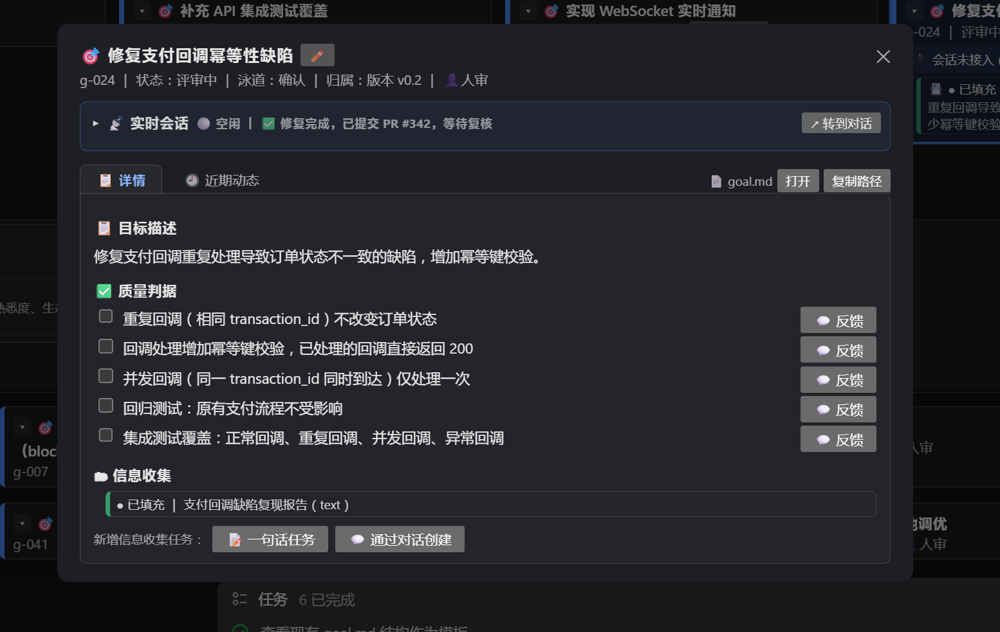

# dsh-graph

把工作组织成**目标看板**的 [DeepSeek Harness](https://github.com/deepseek-ai/deepseek-harness)（DSH）插件 —— 基于图的目标管理（Graph-based Goal Management）。

<p align="center">
  
</p>

<p align="center">
  <a href="https://www.npmjs.com/package/dsh-graph"></a>
  <a href="https://www.npmjs.com/package/dsh-graph"></a>
  <a href="https://github.com/miuzel/dsh-graph/blob/main/dsh-graph-host/package.json"></a>
  <a href="https://awesome-dsh-plugin.com"></a>
  <a href="https://github.com/miuzel/dsh-graph/blob/main/dsh-graph-host/LICENSE"></a>
  <a href="https://github.com/miuzel/dsh-graph/blob/main/dsh-graph-host/package.json"></a>
</p>

**当前版本 v0.24.0** —— npm 包名 `dsh-graph`，一个包同时提供面向 Agent 的 53 个 `graph_*` 工具（含 `/api/dsh-graph*` REST 端点）与内嵌 DSH Web 的二维泳道看板。

**最新亮点（v0.24.0）**

- **专家子代理可承接新目标**：`graph_start_attempt` 支持把**空闲**专家子代理（如 Agent Teams 成员）带上下文接到另一个目标上，免去重建与重读；运行中的一律拒绝，同一专家不会被两个未交付目标同时占用。
- **关照唤醒不再连续打扰**：多个子代理的关照到期时间相近时合并为一次唤醒批量投递，不再隔几十秒连续叫醒主管；先到期任务最多顺延一个合并窗口。
- **关照纪律不再重复注入**：唤醒正文改为「首次全量、后续精简」，多目标巡检时省下的篇幅随目标数放大（10 目标约省 85%）；精简版仍保留判据定义与两条防误判纪律，可用 `supervisor.care_wake_compact: false` 一键退回旧行为。
- **支持 DSH 0.2.2 宿主**：v0.25.0 起声明范围收窄为 `>=0.2.2-rc.3 <0.2.3-0`，并在 `0.2.2-rc.3` 上完成安装、启动、派发、子代理生命周期与看板读写验证（升级说明见 [docs/host-compat-v0.25.0.md](docs/host-compat-v0.25.0.md)）。**`0.2.2-rc.1` / `rc.2` 已不在支持范围**：其所需的嵌套 activation spec 分支已删除。
- **测试基线恢复全绿**：修复真实宿主测试夹具对新宿主的适配，全量自证由 142 例漂移失败恢复为 2920+ 全绿。

变更史见 [CHANGELOG.md](https://github.com/miuzel/dsh-graph/blob/main/CHANGELOG.md)。

## 平台状态

| 平台 | 本版状态 |
|------|----------|
| Linux / WSL2 | ✅ 已实测通过（本版全量测试 fail 0；H 系列共享探针在本版全绿） |
| 原生 Windows | ✅ **本版已实测通过（2026-11-02，win32/x64 + Node v24.21.0，宿主 `0.2.1-rc.5`，通过 22 / 失败 0 / 告警 0）**：详见 [platform-gate §7.13 回填表](docs/platform-gate.md) —— T1 静态/台账（67 项 268 处命中未登记 0）/ 派发可用（零硬编码 shell 名）/ H 组合探针（H1–H6 除 H3 外全绿）全部通过；T3 看板文件系统生命周期 32 步盘面断言全通过；T4/T5 实例启动就绪与 REST 鉴权换票冒烟通过。 |
| macOS | ⏳ **本版未验证**：`v0.23.0` **未**在原生 macOS 上执行真机门禁 ⇒ **不得读出「已通过」**；结论同样以[平台门禁](docs/platform-gate.md) §7 回填表（不随包发布）为准。历史记录见 §7.4 / §7.7，只覆盖各自版本的产品代码。 |

三平台共用同一安装包。已知限制：① macOS 默认文件系统 APFS 大小写不敏感——仅大小写不同的目标编号 / 版本泳道会落到**同一实体**，请勿只用大小写区分；② macOS 上**经显式传入且含符号链接**的工作区路径（如位于 `/tmp`、`/var` 之下）会被拒绝并报 `graph root symlink is not allowed`，由 `process.cwd()` 推导的路径不受影响。

## HTTP 鉴权（Web 入口）

Web 宿主里的 `/api/dsh-graph/**` 走**单一受保护入口**：只注册一条 `prefix` 路由，每请求先由宿主公开的 `connection.admit` 鉴权、再判定 owner，之后才分发业务。未通过 ⇒ `401`（匿名/凭证无效）、`403`（信任边界或非 owner）、**`503`**（宿主没有 `admit` 等能力不可判定情形，fail-closed）。该入口**只影响 HTTP**：`graph_*` 工具面不经过它。

鉴权行为只在 DSH `0.2.1-rc.2` 实测；`engines.dsh` 声明的其它宿主版本未逐版验证。完整口径见 [dsh-graph-host/README.md](dsh-graph-host/README.md#http-鉴权web-看板的-rest-入口)。

## 安装

```sh
dsh plugin --profile <name> add dsh-graph
```

需要 Node ≥ 22。依赖说明、宿主兼容范围（`engines.dsh` 声明与实测宿主）、侧边栏用法、数据目录等完整内容，见 **[dsh-graph-host/README.md](dsh-graph-host/README.md)**（即 npm 包内 README）。升级宿主后若 Web 看板半边不激活（`web boot: … did not activate`），见该 README 的「[升级残留自检与清理](dsh-graph-host/README.md#升级残留自检与清理)」。

## 命令行（dsh-graph）

包内提供轻量 CLI（不依赖常驻服务、网络或第三方 CLI 框架），可直接读写工作区的 `.dsh-graph/`：

```sh
npx --package dsh-graph dsh-graph info          # 环境自检：Node 版本 / graph root / 初始化状态 / 关键文件可读性
npx --package dsh-graph dsh-graph status        # 目标数、事件数、最近事件、规则库版本
npx --package dsh-graph dsh-graph goal list     # 列出目标（--all 含归档）
npx --package dsh-graph dsh-graph goal show g-1 # 单个目标（元信息 + 正文）
npx --package dsh-graph dsh-graph claim g-1     # 认领目标：推进到 in_progress 并输出「目标 + 判据 + 边界」任务单
```

> 除 `sync`（投影上下文）与 `claim`（认领目标）外，其余命令全部只读。`claim` 是**唯一会写看板**的命令：
> 它经 core 状态机把 `planning`/`collecting`/`ready` 推进到 `in_progress`（事件先行），
> 然后把轻量任务单打到 stdout；已是 `in_progress` 时幂等成功（不写事件）。

> `npx --package dsh-graph dsh-graph …` 是**不预先安装**的写法（临时拉包后执行其 `bin` 条目）；
> 已装进 `devDependencies` 时直接用 `npx dsh-graph …` 或 `./node_modules/.bin/dsh-graph …`。
> 本 CLI 的实测平台为 **Linux / WSL2**；**Windows / macOS 未验证**（未做真机兼容性测试，
> 尤其未经 Windows 上 `npx` 与路径分隔符链路验证）。

用法、退出码、路径定位规则与冷启动实测口径见 **[docs/dsh-graph-guide.md](docs/dsh-graph-guide.md)**。

## 核心概念

- **基于图的目标管理**：目标是自足实体 —— 自然语言任务 + 动态生成的取证计划与质量判据；任务类型不预先模板化，结构化的是生命周期与求值语义。
- **四阶段生命周期**：`描述 → 收集 → 执行 → 确认`，由引擎强制的状态机：`draft → planning → collecting → ready → in_progress → review → delivered`（任意阶段可进入 `blocked`）。
- **判据先于执行**：进入执行前先登记质量判据，评审按逐条判据核验产出物。
- **上下文卡片**：目标 Runner 的种子上下文，生命周期 `empty → collecting → filled → reviewed`；形态分文本 / 文件 / 图片 / 数据。
- **排期**：Backlog（暂存池）↔ Version（批量质量管理）↔ 独立目标（standalone）；看板泳道顺序是展示态，可拖拽调整。
- **分级评审与策略配置**：支持配置项目专属模块区域 `review.regions`、冻结契约 `review.contract_paths` 与排除前缀 `review.non_product_prefixes`，未登记区域自动安全升级 strict，空契约默认 M1 不触发。
- **换会话交接**：`graph_handoff` 生成交接文档（board 投影 + 长期记忆 + 环境事实），`graph_claim_supervisor` 由新会话幂等接管。
- **目标间关系**：目标之间可标记「取代 / 调整 / 补充 / 相关」四类关系（`graph_set_relation`，可增可删）；关系只记在目标 frontmatter 这一处真源，看板卡片与目标弹窗直接可见。
- **Profile 全局设置**：子代理默认 provider / model、推理档位、执行模式、提示词语言与补充提示词，可在「设置 → 看板设置」「右侧栏 → 插件 → dsh-graph」两处任一打开，两处读写同一份 profile 配置（workspace `project.yaml` 明确配置优先）。

## 提供的工具

53 个 `graph_*` 工具，按功能分组（逐个说明见 [dsh-graph-host/README.md](dsh-graph-host/README.md) 或 `graph_help`）：

| 分组 | 工具 |
|------|------|
| 目标生命周期 | `graph_create_goal` · `graph_rename_goal` · `graph_set_description` · `graph_set_goal_type` · `graph_set_goal_tags` · `graph_set_goal_budget` · `graph_amend_goal` · `graph_transition` · `graph_postpone_goal` · `graph_archive_goal` · `graph_unarchive_goal` · `graph_delete_goal` · `graph_clean_worktree` · `graph_list_worktrees` |
| 目标关系 | `graph_set_relation` |
| 质量判据 | `graph_set_criteria` |
| 上下文卡片 | `graph_add_card` · `graph_fill_card` · `graph_review_card` · `graph_bind_collect_card` · `graph_delete_card` · `graph_convert_card_to_shared` · `graph_convert_card_to_owned` · `graph_attach_shared_card` · `graph_detach_shared_card` · `graph_list_shared_cards` |
| 附件 | `graph_store_attachment` · `graph_delete_attachment` |
| 排期 | `graph_move_goal` |
| 执行派发 | `graph_start_attempt` · `graph_start_review` · `graph_set_directive` · `graph_record_attempt_handoff` · `graph_unbind_goal_child` · `graph_abandon_attempt` |
| 记忆 | `graph_memory_add` · `graph_memory_recall` · `graph_memory_remove` · `graph_memory_replace` |
| 配置管理 | `graph_get_settings` · `graph_update_settings` |
| 校验 / 对账 | `graph_validate` · `graph_rebuild` |
| 状态汇报 | `graph_report_status` · `graph_report_supervisor_status` · `graph_care_outcome` |
| 评审裁决 | `graph_resolve_accept` |
| 历史讨论 | `graph_add_comment` |
| 完成摘要 | `graph_write_results` · `graph_refresh_results` |
| 换会话 | `graph_handoff` · `graph_claim_supervisor` |
| 帮助 | `graph_help` |

### 复用专家子代理（`graph_start_attempt(child_id=...)`）

把任务交给**已存在的专家子代理**时，用 `graph_start_attempt(goal, child_id=<专家 id>)` 派发，
不要对它直接 `send_message` 私聊派活——前者会把目标推进 `in_progress`、落到 attempt 归属、
纳入关照调度并留 `attempt.bound` / `attempt.reused` 事件。

- **只接受空闲**子代理：运行中一律拒绝（可读错误、零副作用），因为向运行中的子代理投递会被宿主当作
  steer 合入当前步；
- **跨目标独占**：同一 child 不得同时绑定多个未交付目标的活跃 attempt；归属与关照键含
  项目+目标+attempt+child+绑定版本+代际，`A/att-001` 与 `B/att-001` 不串账；
- **投递不确定即 fail-closed**：只有宿主确证受理才回 `delivery=accepted / started=true`，
  否则回 `child_error` 并记 `attempt.reuse_failed`；
- 旧轮迟到的 `subagent/end` 不污染新目标；复用后关照按新绑定重新计时；
- **复用不切换工作目录、不改变工具权限**（继承创建时的父会话），也不创建 worktree
  （`worktree=false`、`worktree_reason=reused_child`）。**worktree 是工作位置隔离，不是权限隔离**
  ——同属工作区根的兄弟树仍可写，只有越出沙箱根才被拒绝。

## 看板（浏览器客户端）

浏览器二维泳道看板：横向为生命周期阶段列（描述 / 收集 / 执行 / 确认 / 交付 / 阻塞），每个版本一条泳道，另有 Backlog 与独立目标区；支持拖拽排期、判据 / 上下文卡片抽屉、实时状态显示、阻塞折叠等。以下为虚构演示数据（nebula-notes）截图：





## 侧边栏与数据目录

侧边栏入口、窄档（<480px）分档行为与「怎么把看板放进窄档」的实测说明，以及数据目录 `<workspace>/.dsh-graph`（纯文本 + 只追加 `events.jsonl`，git 友好、可 `graph_rebuild` 对账）的完整说明，均见 [dsh-graph-host/README.md](dsh-graph-host/README.md)。

## 仓库结构（monorepo）

- `core/` —— 核心层源码（唯一事实源），经 `scripts/sync-core.sh` 编译成 `dist/core/*.js` 进发布包；核心层不依赖 DSH。
- `dsh-graph-host/` —— 单包发布物源码：`index.js`（工具 + REST 端点）、`lib/client/*.js`（看板源模块，构建产物为 `dist/lib/client.js`）、`cordis.patch.yml`、`supervisor-guide.{zh,en}.md`、`README.md`、`LICENSE`。
- `schema/`、`docs/`、`scripts/` —— 数据 / 设计文档 / 构建脚本；一切构建产物落在 `dist/`（gitignored）。

## 开发

```sh
bash scripts/build.sh                 # 同步 core + 客户端产物 + 复制发布资产到 dist/
node --test core/tests/*.test.ts      # 全量测试
./node_modules/.bin/tsc --noEmit -p tsconfig.json
# 隔离测试实例（不碰主 GUI）：DSH_HOME 与 workspace 均在 ./tmp/dsh-test/ 下
bash scripts/dsh-test-web.sh <DSH版本> [--port PORT]
```

构建与实验一律在隔离 worktree（`.worktrees/<goal>-att-<NN>`）内进行；约定见 [AGENTS.md](AGENTS.md)，隔离实例参数与开发回路见 [docs/dev-instance-guide.md](docs/dev-instance-guide.md)。README 截图用 `scripts/dsh-graph-mock-seed.mjs` 生成虚构演示数据后复现。

## License

MIT（Copyright © 2026 miuzel）—— 见 [dsh-graph-host/LICENSE](dsh-graph-host/LICENSE)。
