# dsh-graph / goal-graph v1.0.0 多包设计

## 1. 结论先行

v1.0.0 把原先的单包拆成 **5 个可独立安装的 npm 包**（DSH 专属插件本体保留 `dsh-graph`，跨宿主产物统一去 `dsh-` 前缀命名为 `goal-graph-*`）：

| 包 | 职责 | 用户场景 | 独立可用 |
|---|---|---|---|
| `dsh-graph` | DSH 插件本体：`graph_*` 工具 + 二维泳道看板 | DSH 用户 | ✅ 只装它即可 |
| `goal-graph-cli` | 命令行（`goal-graph`）：`info`/`status`/`goal`/`version`/`sync`/`claim`/`submit`/`serve`/`mcp` | 单兵终端与外部宿主零配置 stdio | ✅ 只装它即可 |
| `goal-graph-service` | 本地服务：Web App + Web API + localhost HTTP MCP + stdio MCP 运行时 | 要 Web / MCP 入口 | ✅（驱动入口见 §3.2） |
| `goal-graph-skills` | 技能包（`goal-graph-skills`）：`dsh-graph` / `dsh-graph-supervisor` 正文与安装脚本 | 按需加载技能 | ✅ |
| `goal-graph-mcp` | MCP 适配器（`goal-graph-mcp`）+ Claude Code / Codex / OpenCode 配置生成（默认 stdio，可选 HTTP） | 接入外部 Agent | ✅（stdio 需 CLI；HTTP 需 serve） |

「单包能力与拆分前等价」的判据：插件包保留 `index.js` + `lib/` + `prompts/` + `diagrams/` +
`cordis.patch.yml` 与全部 `graph_*` 工具（68 个导出、`graph_*` 工具集不变）；
CLI 包保留全部子命令与语义；看板数据格式、事件格式一字未动。



[交互式架构图](../dsh-graph-host/diagrams/design-philosophy.architecture.html) · [暗色版](assets/design-philosophy.architecture.dark.svg)

## 2. 关键约束与取舍

### 2.1 为什么是「打包层」而不是真 monorepo

两道守卫把源码位置钉死：

- `scripts/run-tests.mjs` 的 `TEST_GLOB = "core/tests/*.test.ts"` 字面量与无参行为不得改；
- `tsconfig.json` 的 `include` 是**精确枚举**，出现 `core/**` 或 `dsh-graph-host/**` 会被 g335 判红。

搬动 `core/` 或 `dsh-graph-host/` 会同时击穿两者，而收益为零（单用户场景，无独立版本发布需求）。
因此：

> **源码位置一律不动；`packages/<name>/` 只是「从 `dist/` 取产物组装」的打包层。**

`scripts/pack-packages.mjs` 读 `dist/`（构建产物），按模块图推导每包文件集，组装到
`packages/<name>/`，再 `npm pack` 出 tarball。它**只读 dist、从不构建**——构建仍只走
`bash scripts/build.sh`（原子发布）。

### 2.2 共享运行时为什么「复制」而不是「声明依赖」

CLI 与 SERVICE 共用 24 个 `core/` 模块，且两者互相可达：

- `core/cli/main.js` 对 `core/service/serve.js` 是**动态** `import`（`serve` 子命令）；
- `core/service/queries.js` 反向依赖公共 core（`events/model/ops`）。

可选方案对比：

| 方案 | 结果 | 否决/采纳理由 |
|---|---|---|
| A. 拆出 `goal-graph-runtime` 共享包 | 需把这 24 个模块切出去 | **否决**：等于搬源码，直接撞 g335/g350 |
| B. CLI 声明 `peerDependencies: goal-graph-cli`→service | 装 CLI 不装 service 时 `serve` 子命令炸 | **否决**：违反「不假设其他包已装」 |
| C. 各包把自身闭包整体打包 | 体积各多约 1.5MB（未压缩） | **采纳**：零包间依赖，装哪个用哪个 |

判据 2 原话是「不假设其他包已装，除非显式声明依赖」。C 让**所有包都零依赖**，
是这一判据最强的满足方式；代价只是磁盘体积（tarball 层面已由 gzip 压缩）。

### 2.3 提示词资产的隐性依赖（易错点）

`core/ops.js` 在**运行期**用 `new URL("../prompts/", import.meta.url)` 现读正文，缺资产
**fail-closed 抛错**（不静默降级为空串）。因此：

> 任何携带 `core/` 的包（`dsh-graph` / `goal-graph-cli` / `goal-graph-service`）**必须**把合并后的
> `prompts/` 放在与 `core/` 同级的位置。

打包脚本按「闭包里是否含 `core/`」自动附带 `prompts/` 并在缺失时**抛错**，不靠人工记得。

## 3. 包间依赖

```
dsh-graph             （零依赖；peer: @deepseek-ai/dsh-settings / cordis / schemastery 均 optional）
goal-graph-cli        （零依赖；内含所需 core 运行时 + prompts）
goal-graph-service    （零依赖；内含所需 core 运行时 + prompts；peer: @deepseek-ai/dsh-settings optional）
goal-graph-skills     （零依赖）
goal-graph-mcp        （零依赖；但运行时需要一个已启动的 service endpoint）
```

**没有任何包以 `dependencies` 形式依赖另一个本系列包。** 若将来确需包间依赖，必须用
**精确版本**（如 `"goal-graph-service": "1.0.0"`），不用 `^` 或 `*`——首次发布要保证用户装到的是一套
自洽版本。

### 3.1 版本一致性

五个包版本**统一为 `1.0.0`**（与插件本体 `package.json` / `PLUGIN_VERSION` 同源）。
打包脚本从 `dsh-graph-host/package.json` 的 `version` 取唯一真源，守卫测试逐包断言相等。

### 3.2 service 的驱动方式（如实说明）

`goal-graph-service` 的 `core/service/serve.js` 导出 `runServeCommand`，**本身不是可执行入口**
（该模块是服务生命周期实现，不是 CLI）。故：

- 想要命令行：装 `goal-graph-cli`，用 `goal-graph serve …`（CLI 包内已含服务代码）；
- 想要编程式：`import { runServeCommand } from "goal-graph-service"`。

这是拆分前的既有形状（`serve.ts` 从不是独立 bin），未在本轮改动，以免改变 CLI 语义（判据 6）。

## 4. MCP 三宿主适配

提供两种传输形态，默认零配置 `stdio`：

- **默认 `stdio`（零配置）**：三宿主直接拉起当前工作区的 `goal-graph mcp`（Claude Code / Codex 用 `type: "stdio"`, `command: "goal-graph"`, `args: ["mcp"]`；OpenCode 用 `type: "local"`, `command: ["goal-graph", "mcp"]`），默认 38 读写工具（`--read-only` 为 11 只读工具），并按工作区以 `127.0.0.1:0` 自动起/复用本地 Web 看板，退出自动释放端口。无需手动跑 `serve`、无需固定端口、无需导出 token。
- **显式 `http`（`--transport http [--port <p>]`）**：单一真源 `mcpEndpoint()` 由 `{host, port}` 推导，三宿主共用同一结果，token 一律**只写变量名**：

| 宿主 | 文件 | HTTP 模式 token 引用语法（各宿主原生） |
|---|---|---|
| Claude Code | `.mcp.json` / `~/.claude.json` | `${GOAL_GRAPH_MCP_TOKEN}` |
| Codex | `~/.codex/config.toml` | `bearer_token_env_var = "GOAL_GRAPH_MCP_TOKEN"` |
| OpenCode | `opencode.json` | `{env:GOAL_GRAPH_MCP_TOKEN}` |

`--check` 自检默认同时覆盖 `stdio` 与 `http` 两种模式，断言无任何 token 字面量且引用语法合规。

## 5. 打包与产物

```bash
bash scripts/build.sh                  # 第一步：构建（原子发布）
node scripts/pack-packages.mjs         # 第二步：组装 packages/<name>/
node scripts/pack-packages.mjs --tarballs   # 第三步：npm pack 到 out/ + SHA256SUMS.txt
```

tarball 内**不含**开发资产（源码 `.ts`、`core/tests/`、`.worktrees/`、`dist/` 之外的构建中间物），
由守卫测试逐条断言。

## 6. 不做的事

- 不引入 pnpm workspace / turbo（无独立发布流水线，徒增复杂度）；
- 不 publish / tag / push；
- 不搬动 `core/` 与 `dsh-graph-host/`；
- 不改变 `.dsh-graph` 事件格式、看板行为、`graph_*` 工具集与 CLI 命令语义。
